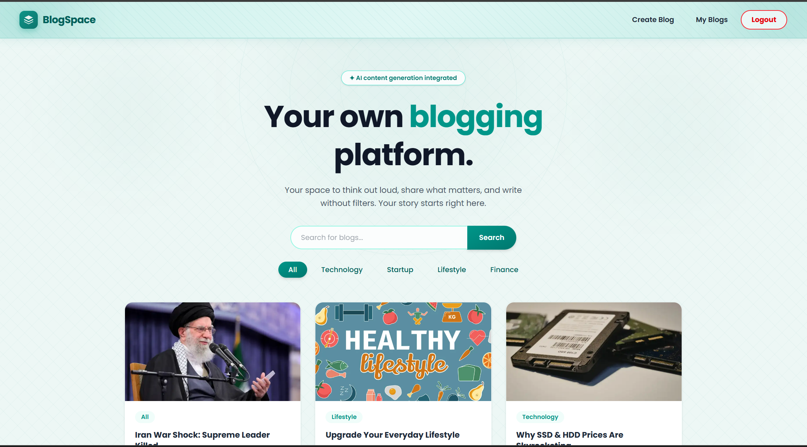
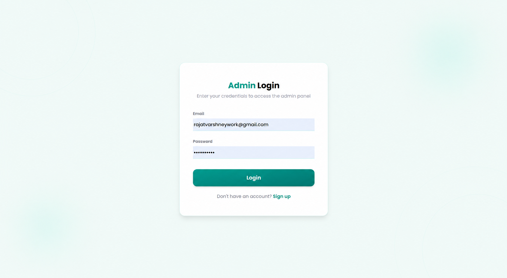
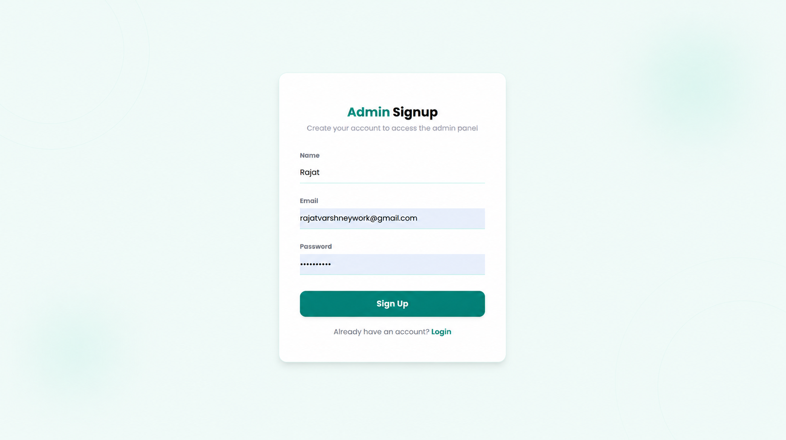
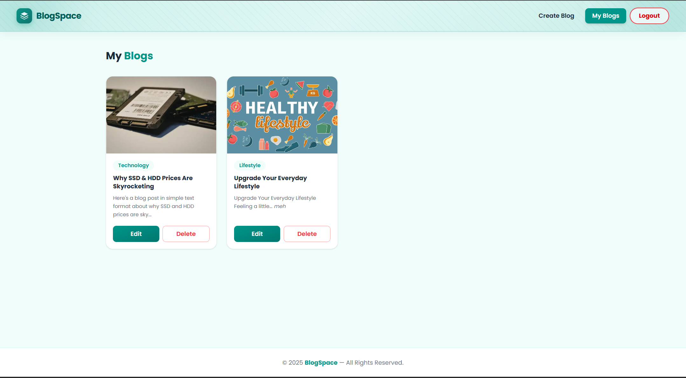
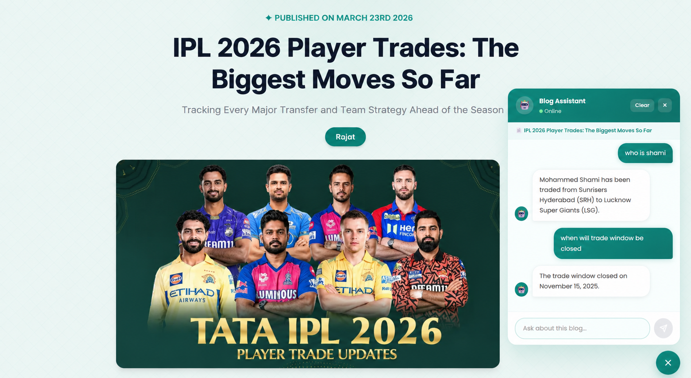
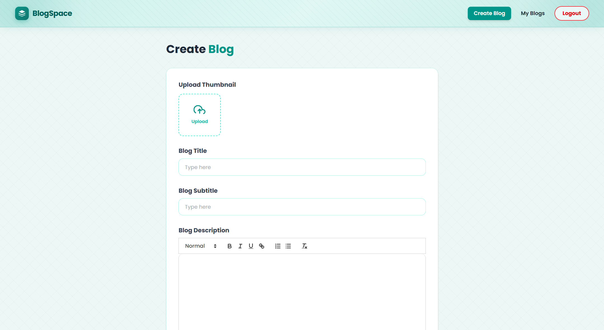

# 📝 BlogSpace

A modern full-stack blogging platform where users can sign up, create, edit, and manage blogs with AI-assisted content generation and a RAG-powered chatbot built using Google Gemini, LangChain, and local embeddings.

---

## 🚀 Features

- 🔐 Signup & login with JWT in an httpOnly cookie, bcrypt-hashed passwords
- ✍️ Create, edit, and delete your own blog posts (ownership checked on the server)
- 🤖 AI content generation powered by Google Gemini + Google Search grounding
- 🧠 RAG-based AI chatbot for context-aware Q&A on each blog, showing which parts of the blog each answer used
- 🖼️ Image upload via ImageKit CDN
- 🔍 Search blogs by keyword
- 🏷️ Filter blogs by category
- 📱 Fully responsive UI built with React + Tailwind CSS
- 🎨 Clean teal-themed design
- ⚡ Local embeddings (zero API calls), stored per chunk in MongoDB and rebuilt automatically when a blog is edited
- 🛡️ HTML sanitization (no stored XSS), CORS allowlist + CSRF origin check, rate limits on login, chat and AI generation
- ✅ Automated tests (unit + API against a real MongoDB) and GitHub Actions CI

---

## 📸 Screenshots

### Home Page


### Login Page


### Signup Page


### My Blogs


### ChatBot


### Create Blog


### Blog Detail


---

## 🛠️ Tech Stack

### Frontend

| Tech | Purpose |
|------|---------|
| React 19 | UI framework |
| Vite | Build tool |
| Tailwind CSS | Styling |
| React Router DOM | Client-side routing |
| Axios | HTTP requests |
| React Hot Toast | Notifications |
| Quill.js | Rich text editor |
| Marked.js | Markdown parser |
| Moment.js | Date formatting |

### Backend

| Tech | Purpose |
|------|---------|
| Node.js + Express | Server |
| MongoDB + Mongoose | Database |
| JWT | Authentication |
| bcryptjs | Password hashing |
| Multer | File upload handling |
| ImageKit | Image CDN storage |
| Google Gemini API | AI content generation + chatbot LLM |
| LangChain.js | Text chunking (RAG pipeline) |
| Xenova Transformers | Local embeddings (zero API calls) |
| Cookie Parser | Cookie management |
| CORS | Cross-origin requests |

---

## 🧠 RAG Chatbot Architecture

Each blog has a context-aware AI chatbot powered by a Retrieval-Augmented Generation (RAG) pipeline.

```text
Blog created / edited
      ↓
HTML stripped → LangChain splitter (1000 chars, 100 overlap)
      ↓
Xenova all-MiniLM-L6-v2 (local) → one vector per chunk
      ↓
BlogChunk collection  { blog, position, text, embedding, version = blog.updatedAt }

User question
      ↓
Question → vector (same local model)
      ↓
Cosine similarity against that blog's chunks → top 3
      ↓
Gemini (system instruction with rules + top chunks, last 10 chat turns, question)
      ↓
Answer + the source snippets it was based on
```

### Design decisions

- **Index on write, not on first question.** Chunks are built in the background right after a blog is created or edited, so the first chat answer is fast. If that fails, the chat endpoint builds them on demand.
- **Versioned chunks.** Every chunk stores the blog's `updatedAt`. After an edit the versions no longer match, so the bot can never answer from outdated text.
- **Separate `BlogChunk` collection** instead of big arrays inside each blog: blog API responses stay small, and the layout is ready for MongoDB Atlas Vector Search if search across all blogs is added later.
- **Local embeddings** (`@xenova/transformers`): no embedding API cost or rate limits; the model (~25 MB) is downloaded once at server start.
- **Guardrails:** questions are capped at 500 characters, history at 10 turns, the chat route is rate-limited, and the system prompt tells Gemini to answer only from the blog and to treat user text as questions, not instructions.

---

## 📁 Project Structure

```text
BlogSpace/
├── client/
│   ├── src/
│   │   ├── components/
│   │   │   ├── Navbar.jsx
│   │   │   ├── Footer.jsx
│   │   │   ├── BlogCard.jsx
│   │   │   ├── AdminBlogCard.jsx
│   │   │   ├── Loader.jsx
│   │   │   └── ChatBot.jsx
│   │   ├── context/
│   │   │   ├── AppContext.jsx
│   │   │   └── UseAppContext.jsx
│   │   ├── pages/
│   │   │   ├── Home.jsx
│   │   │   ├── Blog.jsx
│   │   │   ├── Login.jsx
│   │   │   ├── SignUp.jsx
│   │   │   ├── AddBlog.jsx
│   │   │   ├── EditBlog.jsx
│   │   │   └── MyBlog.jsx
│   │   ├── App.jsx
│   │   ├── main.jsx
│   │   └── index.css
│   ├── index.html
│   └── package.json
│
└── server/
    ├── config/
    │   ├── db.js
    │   ├── env.js
    │   ├── gemini.js
    │   └── imageKit.js
    ├── controllers/
    │   ├── adminController.js
    │   ├── blogController.js
    │   └── chatController.js
    ├── middleware/
    │   ├── authMiddleware.js
    │   ├── multerMiddleware.js
    │   └── security.js        # rate limits + CSRF origin check
    ├── models/
    │   ├── blog.js
    │   ├── blogChunk.js       # RAG chunks + embeddings
    │   └── user.js
    ├── routes/
    │   ├── adminRoutes.js
    │   ├── blogRoutes.js
    │   └── chatRoutes.js
    ├── services/
    │   └── rag.js             # chunking, embeddings, retrieval, prompt
    ├── utils/
    │   └── html.js            # sanitization helpers
    ├── tests/
    ├── app.js                 # Express app (no listen, used by tests)
    ├── index.js               # starts the server
    └── package.json
```

---

## ⚙️ Setup & Installation

### Prerequisites

- Node.js v20+
- MongoDB Atlas account (free M0 cluster is enough)
- ImageKit account (free)
- Google Gemini API key (free tier from Google AI Studio)

### 1. Clone and configure

```bash
git clone https://github.com/Rajjoooo/BlogSpace.git
cd BlogSpace
cp server/.env.example server/.env   # then fill in the values
```

| Variable | Required | Notes |
|---|---|---|
| `MONGODB_URI` | ✅ | Atlas connection string |
| `JWT_SECRET` | ✅ | Any long random string (`SECRET_KEY` from older setups still works) |
| `GEMINI_API_KEY` | ✅ | Google AI Studio key |
| `IMAGEKIT_PUBLIC_KEY`, `IMAGEKIT_PRIVATE_KEY`, `IMAGEKIT_URL_ENDPOINT` | ✅ for creating blogs | Blog thumbnails |
| `GEMINI_MODEL` | – | Defaults to `gemini-2.5-flash-lite` |
| `CLIENT_URL`, `COOKIE_SAMESITE` | – | Only if the frontend is hosted on a different domain than the API |

### 2. Run in development

```bash
# terminal 1
cd server && npm install && npm run dev     # http://localhost:3000

# terminal 2
cd client && npm install && npm run dev     # http://localhost:5173
```

The Vite dev server proxies `/api` to the backend, so no client `.env` is needed.

> On the first run the server downloads the embedding model (~25 MB); later runs use the cache.

### 3. Run the tests

```bash
cd server
npm test                                                        # unit tests
TEST_MONGODB_URI=mongodb://127.0.0.1:27017/blogspace_test npm test   # + API tests
```

The API tests use the real Express app and a real MongoDB, with Gemini, ImageKit and the embedding model replaced by fakes. They cover auth, ownership checks, XSS sanitization, search, CSRF protection and the RAG flow (including "editing a blog refreshes what the chatbot knows"). CI runs them on every push.

---

## 🚀 Deployment (Render, free)

The Express server also serves the built React app, so the whole project is **one web service with one URL**. That avoids CORS setup and third-party-cookie login problems (Safari blocks cookies from a different domain).

1. **MongoDB Atlas:** Network Access → allow `0.0.0.0/0` (Render's free tier has no fixed IP). Copy the connection string.
2. **Render:** New → **Blueprint** → select this repo. Render reads `render.yaml`.
3. Fill in `MONGODB_URI`, `GEMINI_API_KEY` and the three ImageKit values. `JWT_SECRET` is generated automatically.
4. Deploy. Health check: `https://<your-app>.onrender.com/health`.

Manual setup instead of Blueprint: Web Service, root directory = repo root, build command `npm run build`, start command `npm start`, same environment variables.

> Free instances sleep after ~15 minutes without traffic; the first request after that takes about a minute. Open the link once before a demo.

---

## 🔗 API Endpoints

### Blog Routes (`/api/blog`)

| Method | Endpoint | Description | Auth |
|--------|----------|-------------|------|
| POST | `/signup` | Register new user | ❌ |
| POST | `/login` | Login user | ❌ |
| GET | `/profile` | Get logged-in user profile | ✅ |
| POST | `/logout` | Logout user | ❌ |
| GET | `/all` | Get all blogs | ❌ |
| GET | `/` | Search (`?search=`) & filter (`?category=`) blogs | ❌ |
| GET | `/:blogId` | Get single blog | ❌ |

---

### Admin Routes (`/api/admin`)

| Method | Endpoint | Description | Auth |
|--------|----------|-------------|------|
| POST | `/add` | Create new blog | ✅ |
| PUT | `/updateBlog/:id` | Update your own blog | ✅ |
| DELETE | `/deleteBlog/:id` | Delete your own blog | ✅ |
| POST | `/generateContent` | Generate AI content | ✅ |

---

### Chat Routes (`/api/chat`)

| Method | Endpoint | Description | Auth |
|--------|----------|-------------|------|
| POST | `/` | RAG chatbot: `{ blogId, question, history }` → `{ answer, sources }` | ❌ |

### Health

| Method | Endpoint | Description |
|--------|----------|-------------|
| GET | `/health` | Server + database status (used by Render) |

---

## 👤 Author

**Rajjooo**

> Built with ❤️ and a lot of teal 🟢